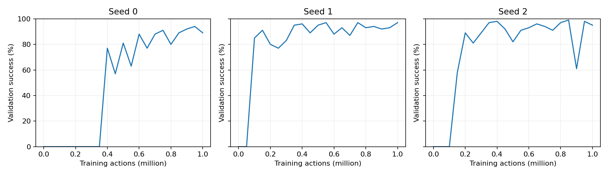

# PPO Baseline v1：实现、复现与结果分析

本文说明本仓库唯一公开的baseline：训练seed **0、1、2**，final作为主结果，best作为补充。所有命令均从仓库根目录运行。

## 1. 任务和实验协议

在 `MiniGrid-DoorKey-6x6-v0` 中训练，智能体需要寻找钥匙、拾取钥匙、解锁门并到达目标。策略只接收 `ImgObsWrapper` 提供的局部7×7符号图像，不接收完整地图或额外状态。

每个seed恰好训练1,000,000个environment actions。每50,000步在固定100局6×6验证集上评估，并保存checkpoint。训练结束后，final在6×6和8×8分别执行100局确定性测试，使用原始环境奖励；8×8零样本测试不继续训练。

三个seed和final／best共享同一尺寸的测试Episode列表。验证与最终测试的Episode seed列表隔离，见[固定列表](../configs/eval_episode_seeds.json)。Episode seed不同不保证几何地图一定不同。

## 2. 模型与PPO配置

| 项目 | 设置 |
|---|---|
| 输入 | 3×7×7局部符号图像 |
| CNN | 三层2×2卷积，通道16、32、64，ReLU；128维输出 |
| 策略／价值MLP | 各两层64单元，Tanh |
| 图像归一化 | 关闭，保留符号编码数值 |
| 并行环境数 | 1 |
| 学习率 | 0.0003，固定 |
| n_steps／batch_size | 2048／64 |
| n_epochs | 10 |
| gamma／GAE lambda | 0.99／0.95 |
| clip_range | 0.2 |
| ent_coef／vf_coef | 0／0.5 |
| max_grad_norm | 0.5 |
| target_kl | None |

完整配置见[baseline.yaml](../configs/baseline.yaml)。不同seed使用相同架构和超参数。

`BudgetPPO`仅将最后一个rollout缩短为576步，使488×2048+576恰好等于1,000,000；不修改PPO的损失函数。总计489次更新、4890个训练epoch、156250次Adam更新。

中间checkpoint在采样过程中触发，尚未执行所在rollout的更新。文件名的 `checkpoint_step` 是已采样步数，旁边JSON的 `last_update_step` 是参数实际更新到的位置。final包含最后576步对应的更新；不能把中间快照文件名直接当作已更新步数。

## 3. 安装与运行

建议Python 3.11。主要版本为PyTorch 2.8.0、Stable-Baselines3 2.9.2、MiniGrid 3.1.0、Gymnasium 1.2.2、NumPy 2.2.6，其余见[依赖文件](../requirements.txt)。

```bash
python -m venv .venv
source .venv/bin/activate
python -m pip install -r requirements.txt
```

默认命令使用CPU，具备相应支持时可将 `--device cpu` 改为 `--device cuda`。选择适合操作系统和计算设备的PyTorch构建，不要求特定硬件或作业调度器。

### 从头训练和测试

以下是长时间任务，请主动启动。输出写入 `runs/seed_0..2/`：

```bash
for seed in 0 1 2; do
  python train_minigrid.py --seed "$seed" --device cpu
done
python baseline.py evaluate --root runs --device cpu
python baseline.py best --root runs --device cpu
python baseline.py summarize --root runs
python baseline.py plot --root runs
```

训练入口拒绝覆盖已有运行目录；评估入口也拒绝覆盖已有测试目录。出现失败时保留现场，不通过反复重训只挑最好一次。

### 短流程检查

```bash
python train_minigrid.py --seed 0 --smoke --total-steps 192 --output runs/smoke_check --device cpu
```

短检查会改变rollout及epoch设置，仅用于验证接口，不属于正式实验结果。

### 核验和重新汇总公开结果

```bash
python baseline.py verify
python baseline.py summarize
python baseline.py plot
```

这三条命令均不训练或执行策略。`verify`检查公开产物哈希、测试列表及模型引用；对默认 `results/` 生成的新汇总和图表写入被Git忽略的 `reports/`，不改动公开证据。对其他 `--root`，默认输出在该目录的 `summary/`；也可用 `--report-dir`指定输出目录。

重新执行公开权重的测试会进行模型推理：先复制 `results/` 到一个新目录，只删除该副本中各seed的 `final_test/` 与 `best_test/`，再对副本运行 `evaluate` 和 `best`。不要覆盖原公开结果。

## 4. Final与best的选择规则

**final是主结果**，对应完整预算及最后一次PPO更新后的模型。

best仅根据6×6验证集选择，排序依次为：成功率高、原始平均回报高、checkpoint步数早；排除0步，包含final。不会依据6×6或8×8最终测试选择模型。规则见[选择协议](../configs/best_checkpoint_selection.json)，具体选择见[记录](../results/best_selection.csv)。

| seed | best文件名步数 | 参数实际更新步数 | 验证成功率 |
|---|---:|---:|---:|
| 0 | 950000 | 948224 | 94% |
| 1 | 750000 | 749568 | 97% |
| 2 | 850000 | 849920 | 99% |

仅发布三个final和三个best权重。best权重就是对应seed的 `checkpoints/` 文件，不重复存放另一份模型；其余周期权重及0步初始化权重不发布，但保留全部周期验证记录和轻量JSON元数据，以核对选择规则。不能用best替换final主结果，或者用测试结果重新调整上述规则。

## 5. 最终测试结果

每个单元均为100个固定Episode。

| seed | Final 6×6 | Final 8×8 | Best 6×6 | Best 8×8 |
|---|---:|---:|---:|---:|
| 0 | 90% | 49% | 97% | 61% |
| 1 | 94% | 43% | 98% | 57% |
| 2 | 93% | 76% | 97% | 56% |

| 模型选择 | 6×6均值±样本标准差 | 8×8均值±样本标准差 |
|---|---:|---:|
| Final，主结果 | **92.33% ± 2.08pp** | **56.00% ± 17.58pp** |
| Best，补充 | 97.33% ± 0.58pp | 58.00% ± 2.65pp |

pp表示百分点。这里的标准差描述三个训练seed之间的变化，不是均值置信区间。逐Episode的Wilson区间也不能替代训练seed间的不确定性；不能把300个Episode当作300次独立训练。

### 平均原始回报与成功步数

“成功步数中位数”仅统计成功Episode，不包含超时失败局。

| seed | Final 6×6回报 | Final 6×6成功步数 | Final 8×8回报 | Final 8×8成功步数 |
|---|---:|---:|---:|---:|
| 0 | 0.872200 | 12 | 0.479228 | 15 |
| 1 | 0.911400 | 12 | 0.419608 | 17 |
| 2 | 0.901450 | 12 | 0.740158 | 19 |

| seed | Best 6×6回报 | Best 6×6成功步数 | Best 8×8回报 | Best 8×8成功步数 |
|---|---:|---:|---:|---:|
| 0 | 0.940125 | 12 | 0.595291 | 17 |
| 1 | 0.949850 | 12 | 0.557470 | 16 |
| 2 | 0.940125 | 12 | 0.546148 | 16 |

完整精度见[逐seed汇总](../results/summary/per_seed.csv)和[跨seed汇总](../results/summary/across_seeds.csv)。

## 6. 学习曲线与详细分析



同时提供[PDF图](../results/summary/learning_curves.pdf)。横轴为累计训练环境动作；纵轴为独立固定6×6验证集成功率，不是训练采样局的滚动成功率。

| seed | 首次验证达到80%的步数 | 归一化Training AUC | final验证成功率 |
|---|---:|---:|---:|
| 0 | 500000 | 0.51075 | 89% |
| 1 | 100000 | 0.83675 | 97% |
| 2 | 200000 | 0.77675 | 95% |

AUC在0至1,000,000的21个验证点上用梯形法积分，再除以训练预算；三seed归一化均值0.70808。首次80%仅表示首次观测到达到阈值，不保证此后一直维持；50k评估间隔也无法确定精确达到阈值的训练时刻。

**训练启动差异明显。** seed0在较长时间后才出现较高的验证成功率，首次80%比seed1晚400k。稀疏奖励下，探索、策略初始化和后续采样轨迹均可能影响学习；当前结果显示现象，但不能单凭曲线定位唯一原因。三个seed最终都学会了6×6，不能把启动较慢直接描述为全程学习失败。

**6×6高成功率没有自动转为稳定的大尺寸迁移。** final的6×6均值92.33%，8×8只有56.00%，且8×8跨seed标准差17.58pp。相同测试场景消除了不同模型使用不同地图列表的混淆，但不会消除训练随机性。仅三个重复，不据此作强统计显著性结论。

**best与迁移表现并非单调一致。** seed0、1的best在8×8分别提高12、14pp，但seed2下降20pp。best的8×8均值仅增加2pp，不能称统一改善。6×6验证集选择出的较好原任务策略不一定具有更强的8×8泛化能力，也不能事后按8×8重新挑选checkpoint。

**终点、峰值与学习效率是不同指标。** best的6×6测试优于final，不代表预算内更早的某个模型应替代正式终点；AUC较高也不保证最终8×8更好。应同时保留final、best补充和完整学习曲线，不只展示峰值。

**验证与测试成功率不同是正常的。** 例如seed0 final验证89%、最终6×6测试90%，来自隔离的Episode列表，不是两个相同指标的重复计算。不能用最终测试分数回填学习曲线。

**证据边界。** 当前逐Episode表提供成功、回报、长度和地图哈希，不包含完整动作序列；不能仅凭这些记录把失败断定为某类转向循环、记忆不足或动作错误。耗时受软硬件和评估开销影响，公开计时字段不用于不同平台性能排名。

## 7. 文件与公开处理说明

- `results/seed_s/final_model.zip`：最终策略；`checkpoints/`：仅保留验证集选出的best权重，其他时刻仅提供轻量JSON记录。
- `validation/`、`learning_curve.csv`：周期验证原始记录及曲线；`logs/progress.csv`、`training.monitor.csv`：训练日志。
- `final_test/`：final测试；`best_test/`：验证集选择的best补充测试；每种尺寸100局。
- `rollout_history.json`与模型旁JSON：预算和更新位置记录。
- `ARTIFACTS.json`：公开产物的SHA256。新生成的汇总和图表使用独立目录，不修改受校验保护的记录。

公开整理移除了个人路径、私有运行清单、平台标识及无关实验。模型ZIP仅替换环境描述条目，参数和优化器等学习内容未改变，测试分数未改变；ZIP整体哈希因此变化，公开结果中的引用已同步更新。`training.monitor.csv`的起始时钟已去标识化，不用于恢复真实日历时间。

模型包含Python序列化对象，只加载可信来源。软件版本和随机种子固定有助于复现，但不保证跨操作系统或计算设备逐位一致。当前公开内容不包括完整课程提交所可能需要的所有演示材料。

## 8. 参考来源与使用说明

- [MiniGrid官方PPO训练教程](https://minigrid.farama.org/content/training/)：训练起点和自定义特征提取器。
- [DoorKey环境说明](https://minigrid.farama.org/main/environments/minigrid/DoorKeyEnv/)：任务与原始奖励。
- [Stable-Baselines3 PPO文档](https://stable-baselines3.readthedocs.io/en/master/modules/ppo.html)：基础算法实现。

本项目依赖和参考上述开源项目，第三方许可证继续适用；新编写代码的仓库许可证应由所有者决定，并按适用要求披露AI辅助实现与整理。发布流程见[GitHub操作说明](../PUBLISH_GITHUB.md)。

公开包不能直接重放未发布时刻的策略；这些权重需按上述训练命令自行生成。`ARTIFACTS.json`仅要求实际发布的六个权重及轻量记录，不要求缺省周期权重。重新训练仍会在被忽略的`runs/`下保存完整checkpoint，不受发布白名单影响。
